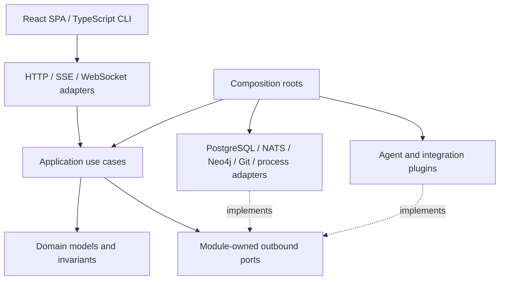
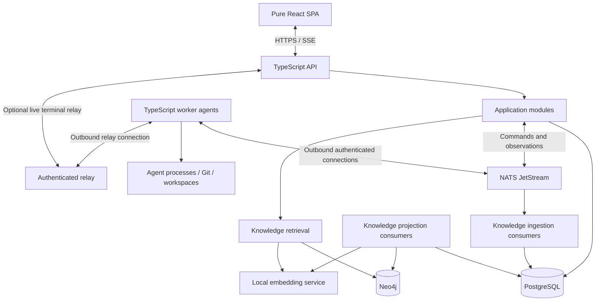

# Taskelith: greenfield software factory architecture and delivery plan

Date: 2026-10-24
Status: Standalone planning baseline, revised after greenfield review R2; implementation and performance claims remain unverified.
Review R2: Single-author design review on 2026-10-24. Eight additional findings are addressed at design level; no independent council or runtime tests are claimed.
Subsequent owner constraint: Use established open-source dependencies only; on 2026-10-24 the owner admitted open or closed agent harnesses and their model providers as plugins ([ADR 0003](https://github.com/petarnenov/taskelith/blob/main/docs/decisions/0003-first-integrations-and-plugin-kernel.md)) and a closed, hosted SCM, GitHub.com, as the first SCM plugin ([ADR 0006](https://github.com/petarnenov/taskelith/blob/main/docs/decisions/0006-github-first-scm.md)). The technology policy below postdates R2; its archived hash describes the earlier revision, not this update.
Project: Taskelith, a new independent repository and deployment. No existing product checkout, data, credentials, infrastructure, or governance is required.
Scope: Build a self-hosted agent orchestration platform from an empty repository. This document supersedes the migration proposal for the new project's scope; the earlier document is historical context only.

## Project identity and owner communication rules

- Product name: **Taskelith** (selected by the owner).
- Repository name, intended npm package name, and CLI command: `taskelith`.
- Product description: **Self-hosted software factory for parallel development and management of multiple software projects.**
- Naming does not imply that a repository, npm package, domain, or trademark has been registered. Availability checks are preliminary and time-sensitive.
- Documentation, code comments, specifications, ADRs, source-controlled reports, commit messages, pull request/issue text, and all other repository content must be written in **English only**.
- Chat, progress updates, reports addressed to the owner, and final answers to the owner must be written in **Bulgarian only**. Preserve exact technical identifiers and commands where necessary.
- If a review or report is saved as project documentation, write that artifact in English and communicate its findings to the owner in Bulgarian. The artifact and communication channels have different language rules.
- Carry these identity and language decisions into the new repository's project instructions and SDLC agent configuration during G0. They apply to all agents and framework plugins, including OpenSpec and SpecKit.

## 1. Objective and architectural direction

Build Taskelith as a self-hosted software factory that develops and manages multiple projects in parallel, with a control plane, remote execution agents, a pure React SPA, and a centralized learning subsystem. Use Node.js and TypeScript for product-owned application code. Organize the product as a hexagonal modular application with a small domain kernel, explicit ports/adapters, and versioned plugins.

All design follows nine first-class principles ([ADR 0004](https://github.com/petarnenov/taskelith/blob/main/docs/decisions/0004-first-class-engineering-principles.md)): Clean Code, SOLID, hexagonal architecture, the plugin microkernel, Docker images for every runnable component, contract-first OpenAPI (and AsyncAPI for messages), Makefile-driven operation, a mandatory SDLC framework with OpenSpec as the default for developing Taskelith ([ADR 0008](https://github.com/petarnenov/taskelith/blob/main/docs/decisions/0008-product-ui-and-integration-authority.md)), and code coverage of at least 75%.

Every agent task participates in a governed specification-driven lifecycle. The SDLC module is a first-class capability. OpenSpec and SpecKit are replaceable framework plugins; neither framework owns the kernel or weakens mandatory review and verification gates.

PostgreSQL stores operational state and canonical knowledge. Neo4j provides the knowledge graph and retrieval projection. NATS JetStream is the preferred durable messaging candidate, subject to a focused protocol/topology spike. Local embeddings support semantic retrieval. Validate correctness before making capacity claims at 10, 100, or 1000 machines.

Start with new code, empty databases, fresh installation identity, and explicitly enrolled workers. There is no legacy runtime bridge, old API compatibility layer, data import, product cutover, or feature-parity obligation. Third-party tools are dependencies; previous project implementations are not prerequisites.

## 2. Confirmed product scope

### Included

- Node.js runtime and TypeScript for product-owned backend, worker, CLI, and plugin code. No product-owned Go code, daemon, bridge, or Go rewrite path.
- Established open-source dependencies only, with explicit edition/license, maintenance, operational evidence, and version-specific acceptance. Agent harnesses and their model providers may be open or closed plugins per ADR 0003, and the first SCM plugin is the closed, hosted GitHub.com per ADR 0006.
- React and TypeScript for a browser-hosted SPA.
- Self-hosted identity, enrollment, host registry, orchestration, storage, and messaging.
- Remote worker agents, including the same remote protocol when worker and server happen to share a machine.
- Hexagonal architecture: domain core, application modules, ports, adapters, and explicit composition roots.
- Versioned plugin contracts for agent harnesses, external integrations, and SDLC frameworks.
- Mandatory spec-driven SDLC for every agent task, including features, fixes, documentation, tests, maintenance, dependencies, infrastructure, and emergency changes.
- Selectable OpenSpec and SpecKit workflows, with exact framework/version binding per workflow run and explicit migration for in-flight work.
- Neo4j-based learning through task history, lessons, relationships, evidence, retrieval, and feedback.
- A design evaluated progressively at 10, 100, and 1000 machines under stated workloads.

### Explicit non-goals

- Electron and its application lifecycle, tray, auto-update, native window, IPC, and desktop integration features.
- A product-owned embedded browser, CDP bridge, browser-profile import, browser inspector, or desktop preview panel.
- Native iOS and Android applications and their pairing/push flows.
- Dependency on any original AO Cloud account, discovery, entitlements, or execution service. The new installation owns its identity and worker registry.

Users open the SPA in an ordinary browser. Tools independently supplied by an installed agent do not imply that the platform implements or manages a browser subsystem.

### Explicit planning assumptions

- One self-hosted installation is the initial security and operational boundary. Project-scoped authorization is required; public SaaS multitenancy and billing are excluded.
- Linux and macOS are the owner-selected initial worker platforms (2026-10-24); Windows is outside the initial worker scope. The initial matrix is Linux on Ubuntu 24.04 LTS in the worker image for x86_64 and arm64, and macOS 26 natively on Apple Silicon and Intel ([ADR 0007](https://github.com/petarnenov/taskelith/blob/main/docs/decisions/0007-g0-closure.md)); native acceptance of each entry remains a gate. See [ADR 0002](https://github.com/petarnenov/taskelith/blob/main/docs/decisions/0002-linux-macos-worker-scope.md) and [worker acceptance](https://github.com/petarnenov/taskelith/blob/main/docs/worker-platforms.md).
- Chat, approvals, Git workspaces, and agent execution are core capabilities. A web terminal for terminal-mode agent integrations is optional pending the initial harness decision; it is distinct from an embedded browser.
- Product state uses an explicit data root with Taskelith-specific defaults and role separation defined in the [G0 storage contract](https://github.com/petarnenov/taskelith/blob/main/docs/storage.md). These are design conventions; runtime initialization is not implemented. Never reuse another installation's identity, secrets, databases, or workspaces. Infrastructure uses explicit persistent volumes. The location of this planning file does not prescribe the new product's storage paths.
- PostgreSQL, Neo4j, NATS, Git, native PTY support if selected, and installed agent binaries are infrastructure/dependencies, not application components to reimplement in TypeScript.

### Established open-source technology policy

Use proven open-source components for infrastructure and common engineering needs. Implement the platform's domain policies, orchestration use cases, ports, and integration adapters; do not build a custom database, message broker, consensus protocol, cryptography, identity protocol, embedding engine, or replacement SDLC framework merely to control the stack. Reuse does not remove the need for application-specific ownership, admission, inbox/outbox, and reconciliation logic.

This policy applies to selected runtime dependencies, infrastructure editions, build/test tooling, shipped plugins, and required execution services. A public repository, free tier, open SDK, source-available license, or proprietary service with an open client does not by itself satisfy it. Avoid mandatory proprietary SaaS and enterprise-only features. Exception: on 2026-10-24 the owner admitted closed agent harnesses and closed model providers as full harness integrations ([ADR 0003](https://github.com/petarnenov/taskelith/blob/main/docs/decisions/0003-first-integrations-and-plugin-kernel.md)). The owner also admitted a closed, hosted SCM as a plugin and selected GitHub.com as the first SCM ([ADR 0006](https://github.com/petarnenov/taskelith/blob/main/docs/decisions/0006-github-first-scm.md)). Any other closed integration still requires an explicit owner scope change. A component with a proprietary edition is admissible when every required feature is in its open-source edition. A component with telemetry on by default is admissible when configuration disables it and a network-egress test confirms that. Until G8, documented non-telemetry traffic to a harness vendor is acceptable and recorded by the egress test. During development, before G8, a license name and one official source suffice as license evidence; G8 requires a full license audit.

All product-owned application code remains TypeScript. Prebuilt third-party infrastructure can use other implementation languages; for example, NATS is a Go implementation consumed as a separate service, not Go application development. Do not introduce a Go build toolchain or Go bridge for product-owned code. A prohibition on every third-party Go binary would require a separate broker selection decision; it is not inferred from the application-language choice.

Before admitting a component, record its exact version/edition, upstream repository and license, supported runtime, release/maintenance history, security reporting process, operational documentation, credible independent usage evidence, and the recovery/upgrade behavior needed by this product. Maintenance and adoption evidence must be relevant to the chosen version; star count alone is insufficient. Prefer stable supported releases and official clients over experiments, abandoned wrappers, and pre-release APIs on critical paths.

Maintain a dependency decision register with statuses `candidate`, `accepted`, `rejected`, and `replacement-required`. Pin package versions/lockfiles and deployment image digests; inventory transitive dependencies and their licenses, produce an SBOM, and test upgrades through the same SDLC gates. These are selection and traceability checks, not a claim that a license scan proves security or operational maturity.

| Component | Open-source baseline | Decision and limitation |
| --- | --- | --- |
| Node.js | MIT plus bundled third-party notices | Established application runtime candidate; select a supported release and inspect the distributed notices. |
| TypeScript | Apache-2.0 | Application language/tooling; pin the selected compiler and build toolchain. |
| React | MIT | Pure SPA; select maintained supporting libraries through the same policy. |
| PostgreSQL | PostgreSQL License | Canonical operational/knowledge storage; test backup, restore, and supported upgrade path. |
| NATS / JetStream | Apache-2.0 | Preferred broker candidate; established project status does not replace topology/recovery tests. Consumed as infrastructure. |
| Neo4j Community Edition | GPLv3 | Required graph implementation in the OSS baseline. No Enterprise dependency or assumption that commercial HA/security capabilities exist in Community. |
| OpenSpec and SpecKit | MIT in their upstream repositories | Required replaceable framework targets; license is distinct from maturity. Version-specific mapping/conformance and maintenance evidence remain admission gates. |
| Agent harnesses | Closed or open; owner-selected Claude Code, Codex CLI, Antigravity CLI, OpenCode | Delivery order and closed-harness scope per ADR 0003, its order amended by ADR 0016; versions, license terms, provider dependency, and capabilities are qualified per plugin. |
| SCM integrations | GitHub.com (closed, hosted) first; Forgejo (GPL-3.0-or-later) later | Per ADR 0006: GitHub App with per-run installation tokens; terms, data handling, API version, maintenance, and security evidence recorded before admission. Forgejo is added once the GitHub integration is proven. |
| Embedding runtime/models | Not yet selected | Choose only after license, operational maturity, provider dependency, and capability verification. |

The licensing facts above were checked against upstream sources on 2026-10-24; they are not certification of a complete pinned dependency tree. The project maturity assessment is preliminary: exact versions, independent usage evidence, and operational qualification were started in G0; the remaining evidence is deferred to named later gates ([ADR 0007](https://github.com/petarnenov/taskelith/blob/main/docs/decisions/0007-g0-closure.md)). If a requested framework fails the maturity bar, record the conflict and seek an explicit scope decision rather than silently exempting it or replacing it with a homemade framework.

Use Neo4j Community behind the application's authorization boundary with application-level project isolation. Keep the graph advisory and rebuildable. If future measured availability/performance needs cannot be met with the selected OSS edition, revise the topology or graph adapter through a reviewed decision; do not silently upgrade to a proprietary edition.

Embedding software and model artifacts require separate review: an OSS inference server does not establish the model's license, redistribution rights, training transparency, or maturity. Record those properties explicitly and do not label merely downloadable weights as open-source by default. The same distinction applies to agent executables and external inference providers. Closed harnesses and their providers are admissible by owner decision; record their terms and provider dependency rather than labeling them open. Outside agent harnesses and the GitHub.com SCM (ADR 0006), the baseline must have no mandatory closed provider dependency.

## 3. Starting conditions and independence

The new project starts with an empty repository and clean infrastructure. Create its own package manifests, lockfile, schema history, CI, contracts, project instructions, and architecture decisions. There are no imported branch names, issue labels, machine addresses, listener restrictions, mandatory model names, or architecture-council procedures.

Prior system experience informs the following design constraints, which are fully stated here and do not require access to its source:

- Delivery acknowledgements do not prove execution completion.
- Worker connectivity and process liveness are separate observations.
- Child processes and their journals need explicit crash recovery.
- Learning records need durable ingestion rather than an in-memory-only queue.
- Lesson exposure is not proof of causal benefit.
- Similar embeddings can describe contradictory advice.
- Framework prompts and task checkboxes are not enforceable SDLC gates.

The project starts with global installation/project/task identities. No mapping from legacy host/session IDs is required. Knowledge begins empty and grows through accepted evidence; optional future import is a separate feature, not a launch dependency.

## 4. Review findings and corrections

These review findings identify risks to address while building the new system. They are design obligations, not evidence of implemented defects or completed fixes. Finding IDs retain continuity with the earlier review; their resolutions below apply to the greenfield scope.

| ID | Severity | Finding | Correction / remaining gate |
| --- | --- | --- | --- |
| F01 | Critical | A transport ACK was too close to being treated as execution durability. | Persist assignments centrally; ACK only records delivery. Reconcile all unfinished attempts. |
| F02 | Critical | Fencing was presented as protection from arbitrary duplicate agent effects. | Fence owned state and mediated operations; classify unreachable execution as uncertain. Do not auto-reassign unsafe work. |
| F03 | High | Starting a process and recording its handle are not an atomic transaction. | Use a durable launch intent, stable execution identity, and an adoptable supervisor. If recovery cannot establish ownership, require reconciliation rather than blind respawn. |
| F04 | High | Worker, session, task, and attempt were ambiguous. | Use the domain vocabulary in section 5 and explicit ownership transitions. |
| F05 | High | Neo4j was called rebuildable without a complete canonical history. | Persist all lesson revisions, relationships, feedback, and retirement records before graph projection. Prove rebuild equivalence. |
| F06 | High | Every served lesson received success/failure attribution. | Preserve outcome correlation separately from explicit usage and helpfulness feedback. |
| F07 | High | Plugin access could bypass kernel invariants. | Plugins receive scoped ports and capability checks; no unrestricted repositories, broker clients, or service locators. |
| F08 | High | Shared broker/graph credentials would scale the blast radius with fleet size. | Per-worker identity, subject authorization, server-side validation, and centralized graph access. |
| F09 | High | A pure SPA was underspecified for remote execution control. | HTTP for commands, SSE for durable UI updates, and an optional authenticated terminal relay with separate buffering. |
| F10 | High | Deployment changes need one authoritative execution owner and a reversible upgrade boundary. | Define fresh installation, version compatibility, drain, backup/restore, and rollback without reactivating conflicting execution. No legacy cutover is required. |
| F11 | Medium | Module boundaries were mostly directory names. | Enforce package exports, dependency rules, public contracts, and adapter conformance tests. |
| F12 | Medium | Machine count was treated as capacity evidence. | Benchmark active attempts, event rate, output volume, disconnect patterns, and storage/recovery time. |
| F13 | Medium | Embedding model identity was underspecified. | Store model revision, preprocessing version, dimensions, and source content hash. Same-size model changes still require re-embedding. |
| F14 | Medium | Inheriting another repository's policies would make the new project unnecessarily dependent on it. | Establish project-owned governance and ADRs from scratch. Preserve generic safety and SDLC obligations without importing old operational rules. |
| F15 | High | SDLC was only a repository convention, allowing agent execution to bypass it. | Add a mandatory SDLC module, stage-scoped admission, immutable artifact/evidence bindings, and completion gates. |
| F16 | High | Making OpenSpec mandatory as a core dependency would lock orchestration to one framework. | Depend on framework-neutral ports; implement OpenSpec and SpecKit plugins with explicit capabilities, version binding, and migration. |

### Greenfield review R2

The architecture is suitable for foundation work, but full implementation must be decomposed through the selected SDLC framework. Fixing this document does not prove that a protocol or integration works. The following findings refine the design without adding desktop/mobile scope or coupling it to another project.

| ID | Severity | Finding | Required design correction and verification |
| --- | --- | --- | --- |
| F17 | Critical | Dispatch-time authorization can be stale when a queued command starts; offline workers cannot know immediate revocation. | Require an online, transactional launch authorization bound to exact artifact/policy/ownership revisions. Define the authorization linearization point and truthful limits of post-authorization cancellation. Verify R27. |
| F18 | Critical | Restoring PostgreSQL can roll back command/deduplication state while workers and the broker retain later work. | Enter restore quarantine, fence launch with a new recovery epoch, reconcile surviving execution, and classify pending commands before dispatch resumes. Verify R28. |
| F19 | High | Chat/approval behavior is core scope but lacks its own durable protocol. | Define turn/request identity, correlated native responses, replay, ambiguous-delivery handling, and provider capability checks separately from SDLC gate approvals. Verify R29. |
| F20 | High | In-process plugins were described both as privileged trusted code and as technically unable to bypass boundaries. | Scope the guarantee to supported SDK access and control-plane authorization. Isolation from malicious plugins requires a process/container boundary. Verify R30. |
| F21 | High | Durable evidence is required while artifact storage is described as optional; a hash or ephemeral worker path is insufficient. | Require an EvidenceStore port and minimum durable content-addressed implementation, authenticated provenance, retention, and corruption behavior. Object storage remains optional. Verify R31. |
| F22 | High | Capacity admission lacks attempt/child budgets and provider limits, enabling oversubscription and retry storms. | Transactional capacity reservations, shared parent budgets, bounded retries, and separately accounted uncertain executions. Verify R32. |
| F23 | High | Ingestion/projection replay can resurrect retired knowledge or overwrite newer revisions; stage changes during a task are underspecified. | Atomic projection version checks, canonical tombstones, recovery generation, and immutable per-attempt context. Verify R33. |
| F24 | High | The phase ordering postpones the second framework until after core abstractions harden, and initial packaging until after a fresh-install gate. | Inspect/test native artifact mappings for both frameworks in G1; build minimal installation tooling in G2/G3, harden it in G6. Verify R34. |

## 5. Domain vocabulary and invariants

| Entity | Meaning |
| --- | --- |
| Machine | Physical or virtual execution host. |
| Worker agent | Enrolled Node.js service managing execution slots on a machine. |
| Workspace | Owned repository working copy or managed directory with placement and lifecycle. |
| Session | Stateful agent conversation and execution context, normally bound to a worker/workspace. |
| Task | User-visible unit of requested work, bound to a workflow run and a stage/work-item identity. |
| Intent | Owner-visible goal that contains one or more campaigns and is itself a proposal of the selected SDLC framework ([ADR 0013](https://github.com/petarnenov/taskelith/blob/main/docs/decisions/0013-intents-campaigns-and-proposal-graphs.md)). |
| Campaign | Sub-goal that groups changes around a dependency graph; campaigns are siblings within one intent ([ADR 0013](https://github.com/petarnenov/taskelith/blob/main/docs/decisions/0013-intents-campaigns-and-proposal-graphs.md)). |
| Blueprint | Framework-neutral manifest of generated nodes and their dependency edges, committed to the repository and generated by the framework plugin ([ADR 0013](https://github.com/petarnenov/taskelith/blob/main/docs/decisions/0013-intents-campaigns-and-proposal-graphs.md)). |
| Council decision | Immutable, audited decision of the three-seat decision council, bound to exact artifact, code, and policy revisions ([ADR 0014](https://github.com/petarnenov/taskelith/blob/main/docs/decisions/0014-decision-council-and-delegated-approval.md)). |
| Workflow run | Durable lifecycle instance bound to a project, selected SDLC framework/version, workflow definition, and governance policy revision. |
| Artifact revision | Immutable content identity and native source reference for a specification, plan, task list, or other workflow output. |
| Gate decision | Evidence-backed authorization of a lifecycle transition for exact artifact, code, and policy revisions. |
| Attempt | One execution attempt for a task, including native provider identity and outcome. |
| Assignment | Scheduler's durable reservation and placement of an attempt on a worker. |
| Command | Idempotently identified request to change an owned resource. |
| Observation | Evidence reported by a worker or integration; not automatically an authoritative transition. |
| Turn | One durable user/agent interaction within a session, with a stable client request identity and provider correlation. |
| Native approval request | A provider permission/input request bound to an attempt, provider handle, and request generation; distinct from an SDLC gate decision. |
| Recovery epoch | Installation-wide launch fence changed through an operator-controlled disaster recovery procedure. |

Core invariants:

1. Every mutation is authorized against installation/project scope and expected ownership generation.
2. A task may have historical attempts, but conflicting active ownership must never be silently accepted.
3. Assignment acceptance, runtime start, command completion, and task outcome are different facts.
4. Loss of contact does not prove process death. Connectivity is orthogonal to execution lifecycle.
5. Session commands target the worker owning that session; an arbitrary queue consumer cannot adopt its filesystem or native conversation.
6. Persist durable facts and derive presentation status; avoid independently mutable display-state copies.
7. Dirty worktrees are not force-deleted as recovery or cleanup.
8. Control-plane restart is independent from worker process lifetime. Worker service upgrades must define whether child runtimes survive or require drain.
9. Knowledge availability is advisory to execution, while accepted learning records are durable.
10. Every agent task, including delegated and recurring work, belongs to an admitted workflow stage. No alternate spawn endpoint bypasses SDLC.
11. Implementation admission and completion depend on validated gates, not a prompt instruction, file existence, a checkbox, or a successful agent exit.
12. Switching framework defaults does not mutate existing workflow runs or carry approvals across changed artifacts.
13. Receiving or ACKing an assignment does not authorize a fresh launch; the worker obtains current online launch authorization.
14. Restoration of operational state never enables automatic replay of execution commands before reconciliation.
15. Session turns, provider approval requests, SDLC approvals, and task outcomes have distinct identities and lifecycle rules.
16. Dependency readiness is necessary but never sufficient: a node also needs a current admission, passed gates, no applicable hold, and a capacity reservation. Operator overrides add constraints and never remove a dependency. A hold's blocked set is the least set containing the held node and closed under containment and dependency; it never includes a prerequisite or an unrelated sibling, and a hold whose blocked set contains a requested node is rejected, naming it.
17. The decision council is a delegated approver bound by evidence. It cannot waive verification, approve its own work, change policy, or authorize any merge into `main`; that merge is owner-only, and the owner can revoke the council's authority.

## 6. Hexagonal architecture



The diagram's implements edges are dependency relationships, not network traffic. Concrete adapters depend on port contracts; domain/application code does not import infrastructure SDKs.

### Modules

| Module | Owns | Explicit boundary |
| --- | --- | --- |
| SDLC | Workflow runs, stage transitions, artifact references, gate decisions, framework bindings, traceability | Depends on framework-neutral ports; framework-specific paths, commands, and parsers live in plugins. |
| Execution | Tasks, attempts, sessions, transitions, approvals/cancellation semantics | Requires stage admission from SDLC; does not select SQL, broker, or agent SDK APIs. |
| Scheduling | Placement, reservations, capacity admission, assignment policy | Uses Fleet snapshots and Execution application contracts. |
| Fleet | Enrollment, identity, compatibility, heartbeat observations, draining | Does not decide task completion from heartbeat loss. |
| Workspace | Workspace ownership, placement, preparation, cleanup | Git is one adapter; lifecycle rules remain in the module. |
| Knowledge | Lessons, evidence, feedback, context policy, versioning | Cypher and embedding transport live outside the module. |
| Access | Principal identity, project authorization, capability decisions | Infrastructure authentication feeds application authorization. |
| SCM / Tracker integrations | Normalized external facts and integration use cases | External SDK DTOs never become core entities. |
| Observability | Structured log records, redaction, the signal catalogue, log and metrics ports | Sinks, exporters, and signal readers are adapters; no logging or metrics library enters the module. |

Each module has `domain/`, `application/`, `ports/`, and an explicit public export surface. Modules do not import another module's internals or read its tables directly. Use synchronous application calls for local consistency requirements; publish durable events for asynchronous propagation. Do not force every in-process interaction through NATS.

The shared kernel is deliberately small: opaque identifiers, basic error vocabulary, and stable event metadata. Domain-specific state machines belong to their owning module. Cross-module transactions must be intentional and documented; avoid a universal repository or generic event bus abstraction that hides consistency requirements.

Ports describe actual application needs. Examples: `AssignmentRepository`, `ExecutionSupervisor`, `WorkspaceProvider`, `KnowledgeProjection`, `EmbeddingProvider`, `AgentHarness`, and `SourceControlProvider`. A transaction boundary must support updating state and appending outbox records atomically.

### Proposed package layout

```text
apps/
  web/
  control-plane/
  worker/
  cli/
packages/
  kernel/
  contracts/
  plugin-sdk/
  testing/
  modules/
    sdlc/
    execution/
    scheduling/
    fleet/
    workspace/
    knowledge/
    access/
    integrations/
    observability/
  adapters/
    postgres/
    nats/
    node-observability/
    neo4j/
    embeddings-local/
    http/
    worker-process/
    git-workspace/
  plugins/
    sdlc-openspec/
    sdlc-speckit/
    agent-primary/
    agent-secondary/
    scm-primary/
```

Plugin directory names are placeholders; the owner-selected harnesses and the GitHub.com SCM are not yet qualified or implemented, and no directory designates an approved package. Names are proposed, not a request to create empty packages. Add modules/adapters when their first real use case is implemented. The owner chose npm workspaces for this layout on 2026-10-24 ([G1 work plan](https://github.com/petarnenov/taskelith/blob/1feb58ba2ec23fdeb4babdc068d0f7080f7ddf27/docs/g1-plan.md), decision D1): the root manifest lists the `packages/` paths above as workspaces, and `apps/*` since G2, whose applications follow the same package contract. Each package is private, named `@taskelith/<directory name>`, keeps its sources in `src/`, its build output in `dist/`, and its tests in `test/`, exposes one root export with types, extends the shared `tsconfig.package.json`, and references the workspace packages it depends on, so that `tsc --build` orders the builds. `make verify` checks this contract, then builds, tests, and measures every package that exists. Code imports another package only by its name and root export, never by a relative path or a subpath. The kernel imports no workspace package, no file outside itself by relative path, and no infrastructure SDK; among workspace packages, a plugin imports only the kernel, plugin SDK, and contracts packages. The deterministic test harness, `packages/testing`, serves tests only: product sources under `src/` of a package or application never import it. Node built-ins and external libraries are governed by the dependency policy, not by these rules. The published root package does not import workspace packages until a distribution strategy for them is decided. Separate packages and exports must prevent worker-only process adapters from entering browser or API bundles: the boundary check treats `apps/worker`, `packages/adapters/worker-*`, and every package that imports a process-launching module of a named list (such as `child_process`, `node-pty`, or `execa`) at runtime, directly or through another package, as worker-only, and fails when `apps/control-plane` or `apps/web` source imports worker-only code.

The SPA consumes versioned API contracts, not backend domain entities. HTTP APIs are contract-first OpenAPI 3.1 documents and broker messages are AsyncAPI documents; types, runtime validation, and clients are generated from them (ADR 0004). All HTTP, message, and plugin inputs receive runtime schema validation. TypeScript types alone are not a trust boundary.

### First-class SDLC with replaceable frameworks

**Product requirement:** all agent work follows the selected specification-driven lifecycle. OpenSpec is an initial supported implementation; SpecKit is an equally supported alternative. Neither framework owns the application kernel. A future framework must satisfy the same port conformance and governance requirements.

The SDLC module is mandatory. The framework adapter is replaceable. Framework-provided terminology, artifact structure, and workflow steps remain native to that framework; do not disguise SpecKit files as OpenSpec changes or force every workflow into OpenSpec's artifact graph.

#### Framework port and ownership

The proposed `SdlcFramework` port exposes capabilities to discover existing work, resolve a versioned workflow definition, describe required artifacts and prerequisites, prepare stage instructions, inspect native artifact revisions, validate structure and references, and perform supported finalization. Operations return typed results and evidence references, not an unconditional approval boolean.

The framework plugin owns native command invocation, file layout, artifact parsing, and mappings from native work-item IDs to stable platform IDs. The SDLC module owns authorized transitions, audit, review requirements, task admission, evidence freshness, and completion. The core must not expose methods named after framework-specific commands such as `openspecApply`.

Framework workflows are versioned stage/dependency graphs, not one hard-coded linear state enum. The product requires recognizable obligations for intake, specification/planning, implementation, review, verification, and closure. Native steps can differ, combine obligations, or include clarification/rework loops. If a framework lacks a required native review or archive operation, an explicit platform-managed gate or closure record supplies that obligation; the UI must distinguish it from a native framework feature.

Do not reimplement a framework's parser or validator in the domain layer. Use pinned supported tooling through its adapter. Framework tools can have non-Node runtimes; those are declared worker tool dependencies, not a requirement to rewrite third-party tools into TypeScript. Adapter compatibility tests bind exact supported framework and workflow versions rather than mutable latest versions.

#### Selection and switching

Selection precedence is: explicit choice for a new workflow run, then project default, then installation default. Validate that the selected plugin supports the project's mandatory governance policy before accepting it. Persist the plugin ID/version, upstream tool version, workflow/schema identity and digest, configuration revision, and policy revision in the run.

The user can say: **"Implement this using SpecKit."** For new work, the platform creates a SpecKit-bound workflow, schedules its preparation stages, and admits implementation when its gates pass. Setting a project default to SpecKit affects future runs only. It does not rename artifacts, rewrite repository instructions, install mutable tooling, or reinterpret running OpenSpec work.

For an existing run, switching is an explicit migration: checkpoint/drain the affected work; preserve original artifacts; map native requirements, tasks, and evidence; identify unsupported/lossy mappings; validate the new artifact set and governing policy; invalidate affected approvals; and record the source/target bindings. If safe conversion is unavailable, retain the original run and create a linked successor after reconciling ownership. No active execution is silently moved to a new framework.

The platform's runtime governance of managed projects is framework-neutral. A managed customer repository may still mandate a framework; selecting a conflicting framework exposes that policy conflict and requires an authorized policy revision. Developing Taskelith itself binds every task to a change of its selected framework without exception, with OpenSpec as the default ([ADR 0004](https://github.com/petarnenov/taskelith/blob/main/docs/decisions/0004-first-class-engineering-principles.md) principle 8 as amended by [ADR 0008](https://github.com/petarnenov/taskelith/blob/main/docs/decisions/0008-product-ui-and-integration-authority.md)); OpenSpec is a default, not a requirement, for every project.

#### Universal lifecycle admission

All entry points converge on the SDLC application service: SPA, CLI, API, tracker intake, schedules, agent delegation, and plugins. No direct task-spawn path can omit workflow identity. A missing specification starts an intake/planning task rather than blocking the ability to create the specification itself.

Planning, investigation, review, and verification agents receive stage-scoped work. Subtasks inherit the parent framework binding and reference a native work item; they do not each require a redundant standalone proposal unless they are independently governed changes. Documentation-only and maintenance tasks still have a workflow, declared impact, review, and evidence appropriate to that work. Emergency work has no untracked bypass.

A representative lifecycle is:

```text
Intake -> Specify/Clarify -> Plan/Decompose -> Approval
       -> Implement -> Verify -> Independent Review -> Integrate -> Close
```

This is a policy illustration, not a claim that both frameworks expose those exact commands; the stage order follows the governance policy's "Lifecycle and records". Rework loops return to the relevant stage. Release/deploy is a separate authorized stage, not implied by closure or agent autonomy.

Before dispatch, the scheduler requires an admission record binding the workflow stage, task/work item, artifact digest, policy revision, and ownership generation. Receiving that record is not permission to launch later without revalidation. Immediately before a new launch, the worker calls the control-plane launch-authority port using the assignment identity and its journaled operation ID. The server transactionally compares the current gate, artifact revision, capacity reservation, worker identity, recovery epoch, and ownership generation, then records one launch authorization. Concurrent invalidation either precedes that transaction and rejects the launch, or follows it and becomes a cancellation/reconciliation request for already authorized work.

That transaction is the authorization linearization point; it cannot be atomic with an operating-system process start. The launch authorization is short-lived and bound to the exact attempt, worker, and execution identity. Its duration and allowable clock skew are explicit protocol parameters. If it expires before launch, or the worker restarts without proof of a start, it obtains current authorization again. Journaled authorization plus an already running process is reconciled by identity rather than blindly launching another one. Safety must not depend solely on worker wall-clock expiry.

An offline worker cannot start queued work or authorize a new stage. Already started work may continue only within its admitted scope and configured offline policy. Revocation after launch is observable and best-effort toward native/external side effects; it is not an instantaneous remote kill guarantee. Stale output is retained as audit evidence and is not accepted as current-policy completion without revalidation.

A changed spec invalidates affected unused implementation admissions and reviews; already started attempts follow the explicit stop/reconcile policy above. A changed code head invalidates head-bound verification/review. Artifact existence, native tool exit success, or a checked task does not prove semantic acceptance. Independent review identities must be distinct from the implementation attempt according to project policy; an unavailable mandatory reviewer leaves the gate pending.

These rules enforce platform scheduling and acceptance. They are not a claim that a trusted shell-capable agent cannot edit files outside its instructed stage. OS isolation, scoped credentials, diff review, and merge protections remain separate controls. Agents cannot authorize their own integration by writing an approval file.

#### Intents, campaigns, and blueprint graphs

Above a change, the model adds the intent and the campaign ([ADR 0013](https://github.com/petarnenov/taskelith/blob/main/docs/decisions/0013-intents-campaigns-and-proposal-graphs.md)). An intent is a proposal whose approved implementation generates campaign proposals; each campaign proposal generates change proposals with their own worktrees, branches, gates, and merge. Generation and execution order are recorded as two separate edge kinds in a framework-neutral blueprint manifest committed to the repository; PostgreSQL mirrors it and Neo4j projects it behind a replaceable port, and dispatch readiness never depends on the projection.

Integration is defined per node: a change when it merged into its integration target and its gates passed, a campaign when all its changes are integrated and its own gates passed, an intent when all its campaigns are integrated and its promotion merge into the project's integration branch completed. Graph readiness, every dependency integrated, is necessary but not sufficient for dispatch: a node also needs a current admission, passed gates, no applicable hold, and a capacity reservation. Independent graph-ready nodes run in parallel within capacity reservations, account slots, and a budget that nests from the intent down to the attempt. Operator overrides only add constraints: a hold covers its blocked set, the least set containing the held node and closed under both containment and dependency, so a prerequisite and an unrelated sibling stay unaffected; an order edge serializes two nodes; a hold whose blocked set contains a requested node is rejected; and a request to run a node in the blocked set is rejected. The approval of an intent covers the specification approval of the generated work and, through the council's standing approval, the ratification of each change's evidence and its merge; verification and independent review remain per change, and a departure from the approved blueprint returns to the parent for a new revision. Changes merge into the intent's integration branch and the promotion-ready intent is promoted into the project's integration branch through its own gate; merging the project's integration branch into `main` is owner-only and no integrator, auto-merge, or council authority covers it.

#### Durable evidence, UI, and learning

Version-controlled native artifacts are the source for specification content. PostgreSQL stores run state, stable identities, gate decisions, immutable revision references, audit, and evidence metadata. Retain content-addressed snapshots where necessary to reproduce an admission after a branch moves; mutable workspace paths alone are insufficient. Avoid competing writable copies in PostgreSQL and Git: native edits create new revisions, then the platform revalidates.

Structural validators can be automated, while semantic approval remains a distinct evidence source. Normalize gate states such as pending, passed, failed, stale, and blocked. Durable compare-and-set transitions and idempotent stage dispatch prevent duplicate delivery or control-plane restart from applying a stage twice. CLI side effects that are not natively idempotent require an operation journal and postcondition reconciliation before retry.

The SPA shows the chosen framework/version, native stages and artifacts, requirement-to-task-to-attempt traceability, evidence, missing prerequisites, and exact reasons for blocked admission. It provides a project default selector and per-run framework choice. No OpenSpec-specific data model leaks into generic task views.

Learning records include framework/workflow version, stage, requirement/task IDs, artifact revisions, review findings, and verification outcomes. Neo4j can relate failures and lessons to lifecycle stages without making graph availability a prerequisite for SDLC gates. Retrieved lessons are advisory; they never modify specifications or grant approvals automatically.

## 7. Plugins and execution isolation

An adapter implements a port. A plugin packages and registers adapters with metadata. Infrastructure adapters such as PostgreSQL and NATS may remain built-in; replaceability is not itself a product requirement.

Plugin contracts include:

- Stable ID, package version, supported plugin API range, and declared protocol capabilities.
- Validated configuration schema and explicit credential requirements; harness plugins declare their subscription mechanisms and the usage, limit, and reset-time signals they report for account pools ([ADR 0005](https://github.com/petarnenov/taskelith/blob/main/docs/decisions/0005-harness-subscription-account-pools.md)).
- Factory plus initialize, health, drain, and shutdown hooks where applicable.
- Capability discovery for chat, terminal, resume, approval handling, interruption, and platform support.
- Explicit error mapping and cancellation behavior.

Use startup registration of pinned trusted packages initially. No hot reload, remote plugin installation marketplace, or arbitrary discovery directories. The composition root validates compatibility before accepting work. The supported plugin SDK exposes scoped ports, never the full dependency container, and offers no method to disable ownership checks or self-authorize integration. Broker credentials and server authorization restrict a worker identity regardless of the adapter it runs. This is not a security sandbox against malicious in-process plugin code.

The plugin model is a microkernel ([ADR 0003](https://github.com/petarnenov/taskelith/blob/main/docs/decisions/0003-first-integrations-and-plugin-kernel.md)). The kernel and modules depend only on ports and declared capabilities. No kernel or module code, type, schema, or test names a specific harness, provider, or SCM. Each integration is a separately versioned package with a manifest. Adding or removing one changes only that package and the composition root's pinned list. Work bound to a removed plugin is drained or rejected, never silently rebound, and its records stay readable.

In-process plugins are trusted code with process privileges. Isolate untrusted extensions in a separate process/container behind bounded RPC if that becomes a requirement. Application-level permissions are not an operating-system sandbox.

Agent processes require scoped credentials (per-workspace Git/SCM credentials and per-run subscription slot credentials, [ADR 0005](https://github.com/petarnenov/taskelith/blob/main/docs/decisions/0005-harness-subscription-account-pools.md)) and an explicit execution trust policy. Protecting the control plane does not contain arbitrary shell commands on a worker. Specify whether workers are dedicated trusted hosts or sandboxed execution environments before enabling untrusted repositories.

### Durable chat turns and provider approvals

The first real agent adapter must specify native capability support for chat, prompt correlation, resume, permissions/input requests, interruption, and exit observation. Do not advertise a capability merely because a generic port has a method for it.

The Execution module owns a durable ordered session timeline. User submissions have a client idempotency key and immutable turn identity; retries do not create another turn. Serialize mutable turns within one session unless a provider contract explicitly supports safe concurrency. Correlate streamed output and terminal outcomes to the native handle, attempt generation, and turn. Bound stream retention and expose snapshot/cursor recovery when older output expires.

Persist a native permission/input request before displaying it. A response must identify the request, originating provider handle/generation, authenticated responder, and current attempt. A response is consumed once in the application journal, but a native provider may not offer exactly-once response delivery. If a timeout or crash makes native delivery uncertain, reconcile with supported provider state or expose an unresolved request; do not automatically approve, replay an unsafe tool action, or send an answer to a new native request with a reused ID.

Runtime approval is distinct from SDLC approval. Passing a specification gate does not approve arbitrary shell execution. Conversely, approving a provider tool call does not authorize integration or completion. A disconnected SPA or revoked user session must not generate default approval. A project-maintainer's standing rule, such as pushing to the task's own branch while auto-merge is on, is an explicit approval policy rather than a default: it records its author, scope, and policy revision, and every use is audited ([ADR 0008](https://github.com/petarnenov/taskelith/blob/main/docs/decisions/0008-product-ui-and-integration-authority.md) decision 2).

## 8. Deployment and data ownership



PostgreSQL holds operational state and canonical knowledge records. Neo4j holds the queryable relationship/vector projection. NATS holds bounded transport retention; it is not the only backup of accepted business facts. Workers keep a local journal and workspaces, using SQLite or another proven local durable store through a port. Local SQLite does not contradict a TypeScript application implementation.

Start with a modular control-plane application and separately runnable background roles. Scale API replicas and consumer processes only when measurements require it. Scheduler replicas need transactional reservation/claim rules, not independent in-memory capacity counters.

### Evidence and artifact persistence

An `EvidenceStore` port is required from G2/G3 for content-addressed immutable snapshots, validation outputs, and review inputs. A durable local volume with checksums, metadata, backup, and authenticated download is sufficient for the first single-server installation; an object-store adapter is a later deployment choice. No accepted gate may depend only on an ephemeral worker path, mutable branch URL, or digest whose bytes cannot be retrieved under the declared retention policy.

Every evidence record includes producer identity, task/attempt/run, input artifact and code revision, validator or reviewer version, outcome, content digest, and capture time. Authenticate evidence publication and authorize which producer may satisfy each gate. A worker-authored JSON result is an observation, not an independently trusted CI/review result by itself. Missing or corrupt required evidence makes the gate unverifiable; do not silently reconstruct it from a current branch. Evidence retention, deletion, and access controls apply to snapshots and their source secrets.

### Resource admission and delegation

Reserve worker slots and requested resources transactionally, with explicit worker-side hard admission limits. Include CPU/memory/disk limits where enforceable, maximum concurrent sessions, provider/account concurrency, retry allowance, and per-project/run budgets. Harness runs also reserve a subscription account slot: the least-loaded eligible slot for the project, with cooldown after limit signals and session affinity (ADR 0005). Native token/cost usage can lag; label estimated versus confirmed accounting and do not promise hard spend limits without provider enforcement.

Delegated children share a durable parent budget reservation and cannot create new independent budgets by changing session IDs. Reconcile actual usage and release reservations only with a justified lifecycle transition. Lost-contact attempts continue to consume reserved capacity until ownership is resolved; uncertainty is not free capacity. Use bounded backoff and fair admission to prevent one project, retry loop, or approval-blocked session from consuming the entire fleet. Low disk and full journals trigger explicit admission pressure and auditable truncation policies for nonessential output, never silent loss of accepted control records.

## 9. Messaging and execution protocol

### Broker decision

Prefer NATS JetStream, conditional on the protocol spike. RabbitMQ quorum queues remain a viable alternative if measured operational requirements favor them; do not deploy both by default.

Official NATS documentation describes streams as persistence over selected subjects and explicit-ack pull consumers with bounded fetch/consume behavior. These primitives support the proposed transport, but do not establish exactly-once agent execution. Sources: [streams](https://docs.nats.io/learn/jetstream/your-first-stream), [pull consumers](https://docs.nats.io/learn/jetstream/pull-consumers).

### Proposed topology to validate

- Persistent addressed worker commands, partitionable by worker pool, with explicit worker identity in routing.
- Durable domain/observation streams with independent consumers for operational projection and learning ingestion.
- No stream or consumer per individual task by default. Compare per-worker command consumers with a bounded routing layer under the 1000-worker test.
- Provision subject/consumer permissions centrally. A worker cannot read another worker's commands or inject another principal's identity.
- Bound retention, bytes, payload size, outstanding acknowledgements, retries, and consumer backlog.
- Quarantine malformed/poison messages with diagnostics and controlled redrive. A retry limit alone is not a dead-letter workflow.

Commands include schema version, command ID, project/task/attempt identity, worker identity, ownership generation, SDLC run/stage and admission revision, correlation ID, and expiry where meaningful. Events include stable event identity, attempt/generation, and per-producer sequence. Cross-producer ordering is not assumed.

### Normal flow

1. Authorize the user request; bind the task to its SDLC run/stage and create the task and outbox entry atomically. Implementation admission requires current prerequisite gates; planning tasks can create missing artifacts.
2. Reserve worker capacity and create the assignment transactionally.
3. Outbox publisher sends the command and waits for broker acknowledgement; retries retain the same command identity.
4. Worker validates the delivered assignment, scope, version, and capability; persists the inbox/launch intent before ACK. ACK does not grant launch permission.
5. Worker obtains current online launch authorization; the supervisor creates or adopts the stable execution identity under its crash-recovery rules and records observations in the local outbox.
6. Server consumes observations, deduplicates, validates transitions, updates operational state, and emits follow-up outbox records atomically.
7. Reconciliation inspects unfinished assignments independently of broker ACK history.

Publish/commit and consume/commit are not cross-system atomic operations. Persisted inbox/outbox identities and idempotent application are required on both sides. Broker deduplication windows are an optimization, not the application's lifetime uniqueness guarantee.

### Failure behavior

| Failure | Required behavior |
| --- | --- |
| Server crashes before publishing | Outbox retries after restart. |
| Publication succeeds but acknowledgement is lost | Retry same ID; receiver does not create another execution. |
| Worker ACKs then process crashes before launch | Recover launch intent, reconcile any possible prior start, and obtain current launch authorization before a genuinely new launch. |
| Child starts before handle persistence | Discover/adopt by stable launch identity; otherwise expose uncertainty and reconcile. |
| Worker disk is lost after ACK | Central unfinished assignment remains; do not assume prior side effects did not happen. |
| Worker loses network while agent runs | Mark reachability unknown; preserve execution ownership until recovery policy resolves it. |
| Old worker reconnects after ownership changes | Reject stale-generation mutations; drain/stop stale execution where possible. |
| Cancel races with start or completion | Versioned transition rules produce an auditable result; cancellation request is not proof of termination. |
| Events arrive out of order | Apply only valid versions; retain/reconcile gaps without regressing terminal facts. |
| Broker is unavailable | Already started execution may continue within the explicit policy; outboxes buffer within limits and new admission applies backpressure. Queued assignments do not start without current launch authority. |
| PostgreSQL is restored to an older backup | Keep launch authority and dispatch quarantined, change recovery epoch, reconcile broker and worker journals, then explicitly authorize any resumption. |

Fencing protects resources that enforce it. It cannot undo an unmediated Git push or third-party API call from an isolated agent. Automatic retries require operation-specific repeatability or confirmed termination; unsafe uncertainty is visible to the operator.

## 10. Learning system and Neo4j

This subsystem improves future task context through accumulated experience. It does not train model weights, generate guaranteed-correct lessons, or turn retrieved text into system instructions.

### Canonical records and graph model

Canonical PostgreSQL knowledge data includes lesson IDs and revisions, source task/attempt, original text, topics, evidence references, confirmations, feedback, supersession/retirement, and context exposure records. Use unique operation IDs for ingestion and feedback to prevent duplicate increments.

The Neo4j projection may contain `Project`, `Task`, `Attempt`, `LessonRevision`, `Topic`, and `Evidence` nodes with relationships such as `ATTEMPT_OF`, `LEARNED`, `ABOUT`, `SUPPORTED_BY`, `RECEIVED`, `USED`, `SUPERSEDES`, and `CONTRADICTS`. Persist the canonical meaning of each relationship outside Neo4j before calling the graph rebuildable.

Projection workers checkpoint progress, tolerate redelivery, and reject stale revisions. Compare-and-apply the canonical revision atomically in the graph transaction, including relationship updates. A retirement/deletion tombstone has its own canonical version; an older upsert cannot resurrect it. Retain tombstones for the defined replay horizon and require a full canonical reconciliation before accepting older replay beyond that horizon.

A projection revision, recovery epoch, and source watermark make lag visible. Restoring an older canonical database invalidates a newer projection until rebuilt or reconciled; graph records cannot be treated as authoritative merely because their revision numbers are higher. Rebuilding into a separate graph/index and switching after validation avoids serving partially rebuilt knowledge. Retrieval validates eligibility/access and retirement against canonical metadata at its defined snapshot boundary, or falls back to no context if eligibility cannot be established. A lesson retired after an attempt started remains in that attempt's historical context snapshot; it is not silently removed or newly injected into an active turn.

### Learning loop

1. Retrieve exact earlier attempts on the same issue/task, then relevant project-scoped lessons and similar work.
2. Build a bounded context snapshot; record exact lesson revisions, retrieval policy, model/index version, and selection reasons.
3. Worker receives the immutable snapshot and may report new lessons with evidence.
4. Persist new knowledge durably, then update graph and embeddings asynchronously.
5. Record task outcomes and explicit usage/helpfulness feedback separately.
6. Review, retire, supersede, or relate conflicting knowledge without silently deleting provenance.

Successful completion is correlation, not proof that every exposed lesson helped. Do not treat outcome-based helped/hurt counters as causal truth. Evaluate retrieval relevance, task rework, repeated failures, and context cost; a small initial data set does not justify improvement claims.

### Retrieval and embeddings

- Apply project authorization before selecting and returning candidates. Global top-K followed only by project filtering can lose relevant project results and must not be the sole retrieval strategy.
- Combine exact task/issue lookup with semantic retrieval and a lexical fallback. Keep ranking explicit and versioned.
- Preserve bounded context and the trust boundary around worker, issue, review, and CI text.
- Persist embedding model ID/revision, preprocessing version, dimensions, and source hash. Same dimensions do not imply compatible vector spaces.
- Centralize re-embedding/backfill with deduplication and bounded concurrency. Do not run a fleet-wide scanner on every worker.
- Do not merge lessons based on vector similarity alone. Preserve contradictory versions and evidence; initially favor duplicate retention over a destructive false merge.
- Retrieval errors or timeouts omit optional context without blocking execution. Accepted lesson ingestion remains durable even when Neo4j or embeddings are unavailable.

### Rebuild and deletion

Prove graph reconstruction from canonical records, including feedback, confirmations, edges, and retirement. Explicit deletion policy must also cover projections, embedding caches, historical snapshots, and backups. Do not promise both permanent plaintext replay and complete deletion without defining retention and redaction behavior.

## 11. SPA, authentication, and live traffic

The SPA's landing page is the per-project board whose columns are the platform lifecycle stages; its screens, board states, design rules, auto-merge authority, and conflict handling are decided in [ADR 0008](https://github.com/petarnenov/taskelith/blob/main/docs/decisions/0008-product-ui-and-integration-authority.md).

Serve the SPA and API behind a same-origin HTTPS endpoint initially. Use server-side authenticated sessions, appropriate cookie protections, CSRF protection for mutations, and server-side authorization. The user authentication provider is a replaceable adapter; a fresh installation must create its own authorized operator access without any legacy account or control-plane service.

Enrollment exchanges a short-lived bootstrap credential for a worker identity. Support rotation, revocation, audit, and bounded permissions. Workers never receive PostgreSQL or Neo4j credentials. Secret values must not enter lessons, prompts, logs, event payloads, or browser bundles by default.

Use HTTP for commands and paged queries, SSE with a durable cursor/catch-up contract for UI updates, and WebSocket only for genuinely bidirectional live flows such as terminals. The SPA reads centrally aggregated views; it never connects to every worker or directly to the broker.

Terminal traffic has its own authentication, session binding, size/rate limits, and bounded buffers. Browser disconnect does not terminate execution. Slow live consumers cannot block command or cancellation delivery. Large artifacts use explicit storage/download paths rather than durable command payloads; select object storage only when artifact requirements justify it.

## 12. Scale and operations

| Stage | Deployment shape | Evidence required before progressing |
| --- | --- | --- |
| 10 machines | One control-plane instance; PostgreSQL; NATS; Neo4j and local embeddings; supervised worker services. Single-node infrastructure implies accepted downtime. | End-to-end correctness, backup restore, partition recovery, identity isolation, and real agent attempts. |
| 100 machines | API/background roles scaled as needed; replicated messaging where availability requires it; bounded scheduling and ingestion. | Backlog recovery, fair placement, drain/rolling upgrades, concurrent UI traffic, and resource budgets. |
| 1000 machines | Worker pools and measured partitioning; centralized read models; throttled reconnect and enrollment; capacity-tested routing. | Workload-specific latency/throughput, reconnect storm, prolonged outages, retention pressure, and recovery time. |

Do not equate 1000 machine connections with 1000 heavily loaded workers. Record sessions per machine, concurrent active attempts, events/second, event size, terminal output, knowledge volume, embedding throughput, and offline duration for every benchmark.

Monitor queue depth/age, inbox/outbox lag, assignment age, unknown execution count, worker capacity, event-loop lag, database latency, projection lag, embedding failures, and retrieval time. Include command/attempt correlation without logging secrets.

A replicated broker does not make PostgreSQL, Neo4j, or workspaces highly available. Select open-source HA topologies and restore procedures separately; proprietary editions are excluded by the technology policy. A single Neo4j instance can initially be acceptable because knowledge retrieval is advisory; do not imply a Community deployment has automatic failover. Set RPO/RTO and latency targets from operator requirements before production acceptance.

## 13. Greenfield delivery plan and exit gates

### Bootstrap without a circular dependency

Before the platform can govern its own development, the initial project owner establishes the repository, a pinned selected SDLC framework, and a versioned governance policy. Agents building the platform use that framework's artifacts and the project's external review/CI checks from the first implementation task. Initial planning/inspection is an explicitly tracked stage, not an ungoverned coding exception.

The initial policy defines who may propose, implement, review, accept, integrate, and release; what evidence each transition requires; and how framework selection is recorded. Do not require an as-yet-unbuilt runtime to approve its own construction. Once runtime admission is verified, register this same project in the platform and link its existing development artifacts without rewriting prior approvals. This bootstrap is not a migration from another product.

### Delivery sequence

| Phase | Work | Exit evidence |
| --- | --- | --- |
| G0: Product and repository foundation (closed 2026-10-24, ADR 0007; deferrals listed there) | Use the selected Taskelith identity and English-artifact/Bulgarian-owner-communication rules; establish its data namespace, owner-selected Linux/macOS worker scope and initial matrix, owner-selected first harnesses (Claude Code, then Codex) and GitHub.com SCM integration (ADR 0006), identity/trust model, and provisional operational targets. Start the dependency decision register and qualify selected editions/licenses and maturity evidence. Create an empty TypeScript workspace, pinned tooling, project-owned SDLC policy, architecture decisions, and CI. | A clean checkout has reproducible setup, typechecking, dependency-boundary checks, a tracked first change, and no reference to another product installation. |
| G1: Domain and SDLC contracts (closed 2026-10-25, ADR 0010; deferrals listed there) | Implement the small kernel, state-transition rules, framework-neutral workflow/stage model, admission records, wire schemas, and port contracts. Inspect representative native artifacts/workflows for both OpenSpec and SpecKit; implement one adapter and run shared mapping fixtures against both designs before freezing the port. | Domain tests reject invalid transitions and unbound implementation tasks. Planning tasks can create missing specs. Structural validation and semantic approval remain distinct. |
| G2: Durable execution vertical slice (closed 2026-10-27, ADR 0015; deferrals listed there) | Implement PostgreSQL state/outbox, NATS transport, enrollment/auth boundaries, a local worker journal, supervisor, and deterministic test harness. Run the real worker protocol even on one host; provide minimal local installation composition, EvidenceStore, launch authorization, and resource admission. | Submit an admitted task, assign it, execute it, and persist its result. Exercise duplicate delivery, process-launch crash windows, partition, cancellation races, stale generations, and disk loss. |
| G3: Usable web product and first real agent | Build the React SPA, self-hosted login, project/task/session views, chat/approvals, Git workspace adapter, and the selected real agent and SCM plugins. | From a fresh installation, an operator enrolls a remote worker and completes a real repository task with inspectable artifacts, independent review, and verification evidence. Browser closure does not stop execution; turn retries and native approval responses survive restart without silently repeating side effects. |
| G4: Prove plugin and framework replacement | Complete both OpenSpec and SpecKit adapters. Add a second real agent harness to prove the agent port is not an abstraction around one SDK. Add UI selection and versioned plugin manifests. | Equivalent feature, fix, and documentation workflows run through both frameworks without core changes. New-work default switching preserves active bindings; incompatible plugins and unsafe in-flight conversions are rejected. |
| G5: Learning from first principles | Implement canonical knowledge records, graph projection, local embeddings, retrieval snapshots, feedback, retirement, and provenance. Start from empty knowledge stores with Neo4j Community and separately qualified embedding software/model artifacts. | One completed task records a lesson; a later relevant task receives its exact revision. Prove replay, graph rebuild, outage fallback, project isolation, contradictory-lesson handling, and model-version reindexing. |
| G6: Operational pilot at 10 machines | Harden the installation packaging introduced in G2/G3; supervise worker services; verify limits, disaster recovery quarantine, backups, enrollment rotation, drain, and upgrades. | Repeat fresh install and restore in an isolated environment; run real workload and failure drills across 10 machines with published resource and recovery measurements. |
| G7: Scale validation at 100 and 1000 machines | Tune routing, admission, pools, consumers, projections, and replicas only from measurements. Exercise reconnect storms, long outages, output pressure, and learning backlog. | Publish workloads, latency/throughput, resource limits, backlog recovery, and unsupported scenarios at each scale. Connection-only simulations are labeled separately from active execution tests. |
| G9: Intents, campaigns, and blueprint dispatch ([ADR 0016](https://github.com/petarnenov/taskelith/blob/main/docs/decisions/0016-delivery-gates-for-intents-and-council.md)) | Implement ADR 0013 decisions 1 to 8 with human approvals: the blueprint mapping as a new versioned operation of both framework plugins, the validated blueprint manifest in Git, graph readiness and parallel dispatch within reservations, `hold`, `release`, and `order`, and the merge ladder through the intent's integration branch and the promotion gate. | An intent generates campaigns and changes with a validated blueprint manifest in Git; graph-ready changes dispatch in parallel within reservations; `hold`, `release`, and `order` behave per ADR 0013 decision 6; changes merge into the intent's integration branch and the intent is promoted through the promotion gate; a stale or missing graph projection neither dispatches nor blocks work; both frameworks produce the manifest. |
| G10: Decision council ([ADR 0016](https://github.com/petarnenov/taskelith/blob/main/docs/decisions/0016-delivery-gates-for-intents-and-council.md)) | Qualify and admit the OpenCode harness plugin as Codex is in G4, then constitute the three-seat council of ADR 0014 (ADR 0013 decision 9) with its decision records, standing approval, and escalation. | OpenCode is admitted; the council decides with Claude Code, Codex, and OpenCode seats under ADR 0014, its decisions are immutable records shown on the board and in the inbox, and a question that cannot convene all three seats escalates to a human. |
| G8: First release readiness | Audit dependencies, including a full license audit, supported capability matrix, installation/recovery documentation, security boundaries, and all requirements below. | Verify the agreed product scope and measurements; retain unresolved gaps explicitly. Release/publishing remains a separately authorized action. |

Each row is an outcome, not a single giant implementation task. Decompose it through the selected SDLC framework into reviewed, independently verifiable work items. G1 precedes G2. G3 follows the recovery foundation in G2. G4 and G5 can overlap after their contracts stabilize, but both are required before pilot completion. G9 starts after G4 closes, may overlap G5, and closes before the G6 pilot completes; G10 follows G9; both precede G8 ([ADR 0016](https://github.com/petarnenov/taskelith/blob/main/docs/decisions/0016-delivery-gates-for-intents-and-council.md)). Gate numbers are identifiers, not the order. Observability and security foundations begin in G0–G2, not at G6.

An early prototype is not the final product: both frameworks, learning, and the required scale evidence remain part of the full scope. No calendar estimate is asserted. G0 fixed the initial integrations and provisional operational expectations ([ADR 0007](https://github.com/petarnenov/taskelith/blob/main/docs/decisions/0007-g0-closure.md)).

The owner recorded the intent, campaign, and blueprint model and the decision council on 2026-10-25 ([ADR 0013](https://github.com/petarnenov/taskelith/blob/main/docs/decisions/0013-intents-campaigns-and-proposal-graphs.md), [ADR 0014](https://github.com/petarnenov/taskelith/blob/main/docs/decisions/0014-decision-council-and-delegated-approval.md)). They authorize no implementation: it starts only on an explicit owner instruction, and the council cannot be constituted before Claude Code, Codex, and OpenCode are admitted, so the full model follows those admissions and a separate owner authorization. [ADR 0016](https://github.com/petarnenov/taskelith/blob/main/docs/decisions/0016-delivery-gates-for-intents-and-council.md) fixes the delivery gates on 2026-10-28: G9 for the intent model with human approvals, and G10 for the OpenCode admission and the council; each gate starts only after the owner authorizes its plan. Their forward-compatibility obligations bind the G3 and G4 designs, traced in the [G3 work plan](https://github.com/petarnenov/taskelith/blob/main/docs/g3-plan.md#adr-0013-and-adr-0014-obligations).

### Fresh installation and deployment

- Provide a self-hosted development/small-install Docker Compose composition of digest-pinned OCI images with explicit volumes for PostgreSQL, NATS, Neo4j, and embeddings, and separately supervised worker agents; Linux workers run in a worker image and macOS workers run natively. Operate it through `make` targets (ADR 0004). Kubernetes is not a prerequisite.
- Generate a unique installation identity and operator bootstrap credential. Require explicit worker enrollment; do not discover/import another application's state automatically.
- Apply this project's own versioned database schemas and graph projection schema. Seed only required configuration, not fabricated lessons or credentials.
- Ensure product-owned orchestration, API, worker, and CLI application code is TypeScript; inventory native third-party dependencies separately.
- Workers initiate outbound connections to configured authenticated control-plane, broker, and optional relay endpoints; do not require public inbound listeners on each worker machine.

### Disaster recovery authority

Restoring PostgreSQL is an operator-controlled mode with launch authority, scheduler dispatch, and command consumers gated before any restored server is exposed. Fence or isolate any surviving old control plane and its launch credentials before activating the restored instance. Increment a monotonic recovery epoch using a durable record outside the restored snapshot, or establish a fresh recovery authority and explicitly re-enroll/reconcile workers if that record is unavailable. Never infer a new authoritative epoch solely from a rolled-back database.

Inventory broker commands and surviving worker journals/processes, compare them with restored assignments, and classify work as completed, running, cancelled, or unresolved. New-epoch admission does not retroactively stop external actions by old workers. Reissue only reconciled safe work; preserve uncertain ownership and evidence. Rebuild graph/read projections against the chosen canonical recovery boundary and invalidate prior stream cursors or resynchronize clients explicitly. Backup restoration can meet an agreed RPO; it cannot promise recovery of records absent from every retained source.

### Upgrade, recovery, and rollback

Greenfield removes legacy migration but not future upgrade obligations. Version application APIs, worker messages, plugin contracts, workflow definitions, and schema changes from the first release. Specify compatible server/worker version windows and fail closed when a worker cannot execute the assigned protocol.

Use expand/contract database changes where rolling upgrades require compatibility. Drain affected execution before incompatible worker/supervisor changes. Keep backups and canonical journals; test restore in isolation, including graph reconstruction and credential handling. Rolling back a binary cannot undo external agent actions or newer data schemas.

Rollback must preserve single execution ownership and the workflow/admission revision attached to each attempt. If safe downgrade is unavailable, stop new admissions and restore or roll forward under an explicit recovery procedure. Never activate a second owner over existing live attempts.

## 14. Acceptance requirements and scenarios

These are proposed requirements, not passed tests.

| Requirement | Verification scenario |
| --- | --- |
| R01: Pure web product | Build and run the React SPA/API in an ordinary browser; confirm no Electron, native mobile app, embedded browser, or original AO Cloud dependency is needed. |
| R02: TypeScript application target | Final deployment manifest contains no required product-owned Go service; native third-party tools remain explicitly inventoried. |
| R03: Hexagonal boundaries | Automated dependency rules reject SDK imports in domain/application code and cross-module internal imports; SPA cannot import server modules. |
| R04: Plugin contracts | Compatible plugin loads; incompatible version/capability/config fails before admission; plugins cannot obtain unauthorized ports. |
| R05: Durable assignment | Crash each outbox/inbox boundary and recover without losing accepted work or silently creating conflicting attempts. |
| R06: Process recovery | Crash around child launch and journal writes; adopt a proven process identity or expose uncertainty without blind respawn. |
| R07: Partition correctness | Disconnect an executing worker, expire contact, and reconnect; verify no unsafe automatic reassignment and reject stale writes. |
| R08: Cancellation/ordering | Reorder start/cancel/result events and redeliver them; terminal facts remain consistent and cancellation truthfully reflects process evidence. |
| R09: Authorization | Worker A cannot read worker B commands, forge B events, query another project's knowledge, or access database credentials. |
| R10: Learning durability | Accept a lesson during graph outage; replay later once, preserving revisions, evidence, and relationships. |
| R11: Graph rebuild | Rebuild from canonical knowledge and compare node/edge identities, revisions, feedback, retirement, and retrieval fixtures. |
| R12: Learning quality | Record context snapshots and distinguish exposure/usage/helpfulness/outcome; contradictory lesson fixtures are not silently collapsed. |
| R13: Projection/model changes | Redeliver and reorder revisions; migrate between embedding models with equal dimensions without mixing vector spaces. |
| R14: SPA streaming | Disconnect/reconnect UI, recover durable updates with cursor/resync, and keep live traffic backpressure independent from control commands. |
| R15: Scale | Run defined 10/100/1000 workloads, including reconnect and outage recovery; publish resource limits and measured results. |
| R16: Operational recovery | Restore PostgreSQL, reconstruct Neo4j, recover transport from outboxes, rotate credentials, and drain/upgrade a worker. |
| R17: Retired legacy-migration requirement | Retired because the project is greenfield. No legacy import or cutover is required. R25 defines fresh-install acceptance; R16 covers ongoing operational recovery. |
| R18: Universal SDLC | Submit feature, fix, docs, maintenance, emergency, scheduled, and delegated tasks through every entry point; each binds to a workflow/stage and cannot start implementation without current gates. |
| R19: Framework replaceability | Run equivalent work through OpenSpec and SpecKit adapters without changes to core modules; unsupported mandatory capabilities fail admission explicitly. |
| R20: Version binding and switching | Switch a project default while an old run is active; only new runs use the new framework. Test successful explicit migration, loss-reporting, and rejected unsafe migration. |
| R21: Evidence freshness | Change a spec, policy, or reviewed code head; affected admissions/reviews become stale, and an agent cannot restore approval by editing a checkbox. |
| R22: Workflow recovery | Restart during stage dispatch and framework tooling side effects; reconcile once, preserve audit, and block offline workers from self-authorizing later stages. |
| R23: Native artifacts and traceability | Inspect both frameworks in the SPA; reproduce admission from exact artifacts and map requirements to tasks, attempts, review, and verification. |
| R24: Governance independence | Use framework-neutral project defaults; for a managed repository with an explicit framework restriction, report a conflicting selection and require an authorized policy revision. |
| R25: Greenfield independence | Starting from an empty repository checkout and empty volumes, bootstrap identity, enroll a worker, complete a governed task, and use a learned lesson on subsequent work without old code, accounts, data, or services. |
| R26: Governed bootstrap | Inspect the first implementation work items: pinned framework artifacts, separate review, and verification evidence exist before the runtime can govern itself; adopting the platform does not fabricate earlier approvals. |
| R27: Launch authorization races | Change policy/spec/ownership after queueing; deny stale launch. Race invalidation with launch authorization and assert the documented order. Disconnect before authorization and ensure no fresh launch; after authorization/start, expose best-effort cancellation honestly. |
| R28: Restore quarantine | Restore an older PostgreSQL backup while broker messages and workers contain newer work; fence old authority, reconcile identities, reject old-epoch starts, and resume only explicitly resolved work without replaying uncertain external effects. |
| R29: Chat and approval recovery | Retry a user turn, reconnect UI, restart during a pending native approval, duplicate a response, and reuse a request ID under a different provider generation; preserve correlation and expose ambiguous native delivery without automatic approval. |
| R30: Plugin trust contract | Verify supported SDK exports are scoped and server/broker authorization rejects overreach from a worker identity. Do not label in-process malicious-code isolation as passed; any untrusted-plugin claim requires a process-boundary adversarial test. |
| R31: Evidence durability and provenance | Delete an ephemeral workspace and move a branch while retaining accepted evidence snapshots. Detect corrupt/missing content and forged producer claims; do not pass independent review/CI gates from an unauthorized worker assertion. |
| R32: Resource and child budgets | Race scheduler replicas, spawn delegated children, disconnect a consuming worker, fill a journal, and exhaust provider limits; enforce reservations, shared budgets, bounded retry, and no silent control-record loss. |
| R33: Projection ordering and recovery | Apply revisions in reverse order, replay a retired lesson, restore canonical state behind the graph, and retire knowledge during execution; prevent resurrection/stale retrieval and preserve historical attempt context. |
| R34: Framework and install feasibility | Before freezing the framework port, validate fixtures from both native workflows; run the G3 fresh-install scenario using packaging produced by G2/G3 without depending on G6 work. |
| R35: Established OSS dependencies | Audit the dependency register, pinned versions/images, license inventory/SBOM, maintenance and usage evidence, and chosen feature editions; reject unqualified, proprietary, and mandatory closed-service dependencies, except owner-admitted agent harnesses and their model providers (ADR 0003), the GitHub.com SCM (ADR 0006), and the optional hosted Tailscale control plane plugin (ADR 0012), whose terms, data-handling, and provider dependency are recorded before admission and whose self-hosted alternatives remain supported. Verify a clean self-hosted deployment without enterprise-only capabilities. |
| R36: TypeScript-only product code | Inspect owned source, build scripts, worker bundles, and deployment inputs for Go application code, Go bridges, or a product Go toolchain. Distinguish prebuilt third-party services from product-owned code. |
| R37: Agent and model qualification | Demonstrate both selected harnesses with recorded license, provider, and data-handling terms (open or closed per ADR 0003), and the learning inference path with approved software/model artifacts and no mandatory proprietary provider; record model license/transparency separately from server/client license and verify required capabilities. |
| R38: Identity and language consistency | Verify the Taskelith name and `taskelith` identifiers in project setup; inspect docs, comments, specs, repository reports and contribution metadata for English, and owner-facing chat/status/report/final messages for Bulgarian. Native technical identifiers remain exact. |

Use pure domain tests, shared port/adapter conformance suites, integration tests with real PostgreSQL/NATS/Neo4j, and end-to-end worker processes. Fake brokers and mocked timers alone cannot prove distributed failure behavior. Include architecture import checks in CI.

## 15. Decisions still requiring evidence or owner scope confirmation

| Decision | Proposed default | What closes it |
| --- | --- | --- |
| Worker OS support | Linux (Ubuntu 24.04 LTS worker image, x86_64 and arm64) and macOS 26 (native, Apple Silicon and Intel), selected by the owner on 2026-10-24 | Scope and initial matrix are decided ([ADR 0007](https://github.com/petarnenov/taskelith/blob/main/docs/decisions/0007-g0-closure.md)). Native acceptance of each entry starts in G2 and completes with the gates its rows depend on (G3, G6–G7). |
| Terminal-mode agents | Optional web terminal, no browser subsystem | Initial harness/capability scope; do not accidentally implement an embedded browser. |
| First integrations | Owner selected Claude Code (G3), Codex (G4), then Antigravity CLI and OpenCode, OpenCode possibly before Antigravity CLI, in G10 (ADR 0016); plus GitHub.com as the first SCM (ADR 0006) and Forgejo as a later second SCM, on 2026-10-24 | Version-specific qualification, provider terms, network-egress tests, and adapter conformance tests per plugin. |
| Framework maturity | OpenSpec and SpecKit remain required candidates | Version-specific upstream maintenance, adoption evidence, and conformance; unresolved conflicts are explicit, not silent exemptions. |
| Inference and model artifacts | Local/open baseline, exact implementations pending | Separate runtime/model licensing and maturity review plus learning/retrieval quality tests. |
| Initial policy and storage | Taskelith name and language rules are decided; managed-project governance remains framework-neutral, and developing Taskelith uses OpenSpec by default with the framework selectable (ADR 0004, ADR 0008) | Storage defaults, roles, and the development SDLC framework recorded in G0; propagate the decided identity and language rules to project instructions. |
| Intents, campaigns, and decision council | Recorded; gates fixed by [ADR 0016](https://github.com/petarnenov/taskelith/blob/main/docs/decisions/0016-delivery-gates-for-intents-and-council.md) as G9 and G10, implementation awaiting the owner's authorization of their gate plans ([ADR 0013](https://github.com/petarnenov/taskelith/blob/main/docs/decisions/0013-intents-campaigns-and-proposal-graphs.md), [ADR 0014](https://github.com/petarnenov/taskelith/blob/main/docs/decisions/0014-decision-council-and-delegated-approval.md)) | The owner's authorization of the G9 and G10 gate plans; for the council, OpenCode admitted in G10. |
| Broker topology | JetStream with bounded addressed command routing | Protocol and 1000-worker topology tests; no claim that the comparison is already measured. |
| User authentication adapter | Self-hosted sessions with replaceable identity provider | Operator identity/recovery requirements and access model defined in the [G0 trust contract](https://github.com/petarnenov/taskelith/blob/main/docs/trust-model.md); runtime adapter implementation in G2/G3. |
| Worker trust/isolation | Explicitly trusted enrolled hosts initially | Threat model for repositories, agents, secrets, and shell execution recorded in the [G0 trust contract](https://github.com/petarnenov/taskelith/blob/main/docs/trust-model.md); runtime enforcement in G2/G3. |
| Availability and retention | Defined per installation | Provisional RPO/RTO, backlog/offline windows, and retention horizons recorded in [G0 operational targets](https://github.com/petarnenov/taskelith/blob/main/docs/operational-targets.md); measured validation in G6/G7. |
| Native runtime survival | Stable supervisor boundary | OS-specific crash/adoption and upgrade evidence. |
| Evidence storage | Required durable EvidenceStore in G2/G3; local content-addressed volume initially | Snapshot retention, authenticated provenance, corruption/restore behavior, and download requirements. Object storage is optional. |
| Launch and recovery authority | Online launch gate plus explicit recovery epoch | Provisional TTL/skew (`30s`/`5s`) and epoch rules recorded in [G0 operational targets](https://github.com/petarnenov/taskelith/blob/main/docs/operational-targets.md) and [trust contract](https://github.com/petarnenov/taskelith/blob/main/docs/trust-model.md); partition/restore tests before G2/G6 completion. |
| Resource budgets | Shared project/run reservations with child accounting | Provisional CPU/memory/disk/session/retry thresholds recorded in [G0 operational targets](https://github.com/petarnenov/taskelith/blob/main/docs/operational-targets.md); native platform enforcement and tests in G2–G7. |
| Network fabric | Local direct addressing by default; Headscale and hosted Tailscale plugins in that order, behind one capability-gated port ([ADR 0012](https://github.com/petarnenov/taskelith/blob/main/docs/decisions/0012-network-fabric-plugins.md)) | Port contract with the first bounded change that adopts it (enrollment already exists from G2 item 13); Headscale qualification toward G6; hosted Tailscale terms, data-handling, and security evidence before admission. |

Readiness is staged. G0 was closed on 2026-10-24 (ADR 0007), G1 on 2026-10-25 ([ADR 0010](https://github.com/petarnenov/taskelith/blob/main/docs/decisions/0010-g1-closure.md)), and G2 on 2026-10-27 ([ADR 0015](https://github.com/petarnenov/taskelith/blob/main/docs/decisions/0015-g2-closure.md)). Before its execution implementation, G2 resolved launch linearization/expiry, supervisor identity and adoption, local journal durability, and capacity reservations into reviewed protocol contracts (G2 work plan items 3 to 6); G1 resolved both-framework mapping feasibility by freezing the SDLC framework port against both frameworks' fixtures (ADR 0009). Before G3 acceptance, resolve first-provider chat/approval semantics and evidence storage. Before the pilot, resolve recovery epoch authority, RPO/RTO, retention, and workload targets. The final benchmark configuration must specify numeric goals before the measurement is judged; thresholds cannot be chosen after seeing results.

These open items do not erase the full scope or justify calling an early prototype complete. They prevent a blanket implementation-ready or production-ready claim and a credible full-build estimate.

## 16. New-project governance and document status

This document is self-contained planning input for a new repository. It imports no `AGENTS.md`, ADR, issue-label convention, branch policy, host allocation, deployment permission, or review-model requirement from another project. Establish those details explicitly during G0.

The required process for managed projects is framework-neutral, and Taskelith's own repository uses OpenSpec by default with the framework selectable ([ADR 0004](https://github.com/petarnenov/taskelith/blob/main/docs/decisions/0004-first-class-engineering-principles.md), [ADR 0008](https://github.com/petarnenov/taskelith/blob/main/docs/decisions/0008-product-ui-and-integration-authority.md)): every agent task has a tracked workflow/stage, specification or justified no-runtime-impact declaration, relevant review, verification, and closure evidence. Project policy defines the identities authorized to approve and integrate. Agents may execute authorized stages autonomously; task completion never authorizes publication or production deployment by itself.

Keep architectural rationale in the new project's ADRs, framework-native specifications in their native version-controlled format, wire contracts in their declared schemas, and evidence tied to exact revisions. This plan's folder sketch is not a set of already existing files. Its requirements and gates are not claims of completed tests.

The earlier migration review is retained separately as historical material. It is not a prerequisite and does not define this project's scope. No runtime code, repository, deployment, benchmark, independent council ruling, or production environment was created by writing this document.

## 17. External references

These sources inform technology and framework integration. Pin and verify the actual selected versions during implementation; links are not acceptance evidence.

- [NATS: streams](https://docs.nats.io/learn/jetstream/your-first-stream)
- [NATS: pull consumers](https://docs.nats.io/learn/jetstream/pull-consumers)
- [RabbitMQ: quorum queues](https://www.rabbitmq.com/docs/quorum-queues) (broker alternative; no comparative benchmark is claimed)
- [OpenSpec upstream](https://github.com/Fission-AI/OpenSpec)
- [SpecKit upstream](https://github.com/github/spec-kit)

- [Node.js license and bundled notices](https://github.com/nodejs/node/blob/main/LICENSE)
- [TypeScript license](https://github.com/microsoft/TypeScript/blob/main/LICENSE.txt)
- [React license](https://github.com/facebook/react/blob/main/LICENSE)
- [PostgreSQL license](https://www.postgresql.org/about/licence/)
- [NATS server source and license](https://github.com/nats-io/nats-server)
- [Neo4j Community source and edition licensing](https://github.com/neo4j/neo4j)

## Automated versioning and package publication

Taskelith uses semantic-release and Conventional Commits for automatic semantic versions, tags, release notes, and npm publication from main after verification. GitHub Actions authenticates to npm through OIDC trusted publishing without stored npm publish tokens or per-release MFA. Account administration retains MFA. See [the release policy](https://github.com/petarnenov/taskelith/blob/main/docs/releases.md) for setup, version rules, and recovery.
